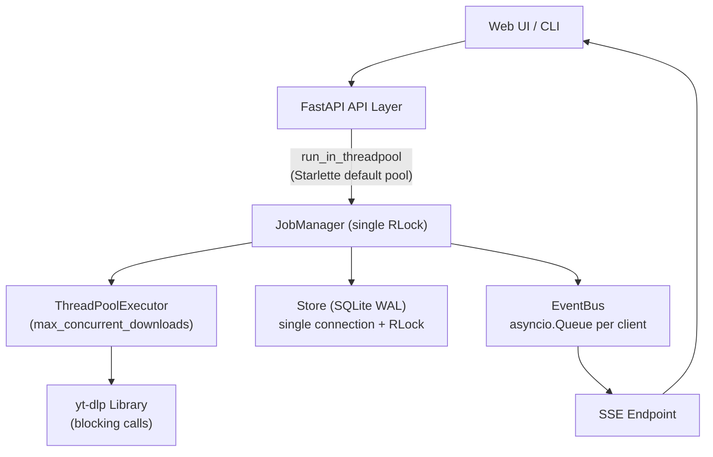
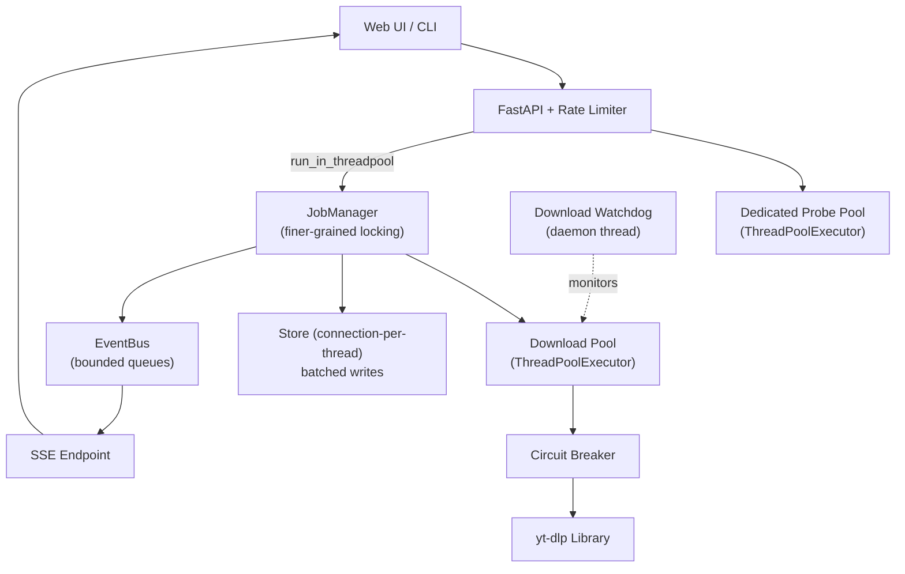

# TurboTube — Speed, Stability & Architecture Overhaul

## Goal
Transform TurboTube from a functional downloader into a **production-grade, resilient system** by applying system design principles across networking, concurrency, data access, observability, and fault tolerance — without breaking the existing API contract or test suite.

## Current Architecture (Before)



> [!WARNING]
> **Key architectural weaknesses identified:**
> 1. **Probe calls block Starlette's shared threadpool** — can starve unrelated API requests
> 2. **No download watchdog** — stuck yt-dlp calls hang workers forever
> 3. **DNS cache uses blunt `clear()` at 512 entries** — thundering herd risk
> 4. **Single SQLite connection** with coarse locking — all writes serialized
> 5. **No API rate limiting** — a malicious client can flood probe/job creation
> 6. **No circuit breaker** — YouTube outages burn through all workers
> 7. **Graceful shutdown is racy** — active downloads may not terminate
> 8. **Probe cache capped at 64 entries** — wastes repeated probe calls
> 9. **No structured logging or metrics** — blind to production issues

---

## Proposed Architecture (After)



---

## User Review Required

> [!IMPORTANT]
> **Breaking behavior changes (all behind new settings, disabled by default):**
> - `TT_RATE_LIMIT_RPM` — new setting for API rate limiting (default: `0` = off)
> - `TT_DOWNLOAD_TIMEOUT` — new per-item watchdog timeout (default: `0` = off)
> - `TT_CIRCUIT_BREAKER_THRESHOLD` — failures before tripping (default: `0` = off)
> - Probe cache size increases from hardcoded 64 → configurable `TT_PROBE_CACHE_SIZE` (default: 256)
>
> All new features are **opt-in** — zero behavioral change for existing users unless they set these env vars.

## Open Questions

> [!IMPORTANT]
> 1. **SQLite vs. aiosqlite**: The plan keeps synchronous SQLite but moves to connection-per-thread pooling. Would you prefer migrating to `aiosqlite` for fully async DB access, or is the simpler connection-pool approach sufficient?
> 2. **Rate limiter backend**: The plan uses a simple in-memory sliding-window counter. For multi-instance deployments (behind a load balancer), would you want Redis-backed rate limiting?
> 3. **Metrics export**: The plan adds internal counters. Would you want a `/api/metrics` endpoint (Prometheus-compatible) or is internal logging enough?

---

## Proposed Changes

### 1. Dedicated Probe Thread Pool (Isolation)

**Problem**: Probes (`expand_playlist` → `probe_media` → `yt-dlp.extract_info`) run in Starlette's shared `run_in_threadpool`, which has ~40 threads. Heavy probe traffic starves other API calls (list jobs, cancel, health checks).

**Principle**: *Bulkhead pattern* — isolate slow operations into their own resource pool so failures/slowness can't cascade.

#### [MODIFY] [api.py](file:///C:/Users/ahmed/OneDrive/Desktop/downloader/app/api.py)

Add a dedicated probe executor and use it for probe and job-creation endpoints:

```diff
 from starlette.concurrency import run_in_threadpool
 
+from concurrent.futures import ThreadPoolExecutor
+
 from . import __version__
 from .config import PROJECT_ROOT, Settings
```

```diff
 log = logging.getLogger("turbotube.api")
 router = APIRouter(prefix="/api")
+
+# Dedicated pool for blocking yt-dlp probes so they can't starve the
+# Starlette default pool used by lightweight endpoints (list, cancel, etc.).
+_probe_executor: ThreadPoolExecutor | None = None
+
+
+def init_probe_pool(max_workers: int = 6) -> None:
+    """Create the probe pool once at app startup."""
+    global _probe_executor
+    _probe_executor = ThreadPoolExecutor(
+        max_workers=max_workers, thread_name_prefix="tt-probe"
+    )
+
+
+def shutdown_probe_pool() -> None:
+    global _probe_executor
+    if _probe_executor:
+        _probe_executor.shutdown(wait=False, cancel_futures=True)
+        _probe_executor = None
+
+
+async def _run_in_probe_pool(fn):
+    """Run *fn* in the dedicated probe pool, falling back to Starlette's."""
+    loop = asyncio.get_running_loop()
+    if _probe_executor is not None:
+        return await loop.run_in_executor(_probe_executor, fn)
+    return await run_in_threadpool(fn)
```

Then replace the `probe` and `create_job` endpoints:

```diff
     try:
-        return await run_in_threadpool(work)
+        return await _run_in_probe_pool(work)
     except UnsafeURLError as exc:
```

```diff
     try:
-        job = await run_in_threadpool(work)
+        job = await _run_in_probe_pool(work)
     except UnsafeURLError as exc:
```

#### [MODIFY] [main.py](file:///C:/Users/ahmed/OneDrive/Desktop/downloader/app/main.py)

Wire up the probe pool in the app lifespan:

```diff
 from .api import router as api_router
+from .api import init_probe_pool, shutdown_probe_pool
```

```diff
         log.info("TurboTube %s ready - downloads: %s", __version__, settings.download_path)
+        init_probe_pool(max_workers=min(6, settings.max_concurrent_downloads + 2))
         if settings.auto_resume:
```

```diff
         finally:
             manager.shutdown()
+            shutdown_probe_pool()
             store.close()
```

---

### 2. Download Watchdog (Stuck Download Protection)

**Problem**: If yt-dlp hangs between progress hooks (e.g., waiting on a stalled TCP connection beyond `socket_timeout`), the worker thread is stuck forever. There's no mechanism to detect or recover from this.

**Principle**: *Timeout pattern* — every external call must have a bounded deadline.

#### [MODIFY] [config.py](file:///C:/Users/ahmed/OneDrive/Desktop/downloader/app/config.py)

```diff
     socket_timeout: int = Field(default=20, ge=5, le=120)
+    download_timeout: int = Field(default=0, ge=0, le=86400)
+    """Per-item wall-clock timeout in seconds. 0 = no timeout (default).
+    Recommended: 3600 (1 hour) for typical videos, 7200 for long playlists."""
```

#### [MODIFY] [manager.py](file:///C:/Users/ahmed/OneDrive/Desktop/downloader/app/manager.py)

Add a watchdog daemon thread that monitors active downloads:

```python
class _Watchdog(threading.Thread):
    """Daemon thread that cancels items exceeding their wall-clock deadline."""

    def __init__(self, manager: JobManager, interval: float = 30.0) -> None:
        super().__init__(daemon=True, name="tt-watchdog")
        self._manager = manager
        self._interval = interval
        self._stop = threading.Event()

    def run(self) -> None:
        while not self._stop.wait(self._interval):
            timeout = self._manager.settings.download_timeout
            if timeout <= 0:
                continue
            now = time.time()
            with self._manager._lock:
                for job in self._manager._jobs.values():
                    for item in job.items:
                        if item.status in ACTIVE and item.attempts > 0:
                            elapsed = now - item.updated_at
                            if elapsed > timeout:
                                log.warning(
                                    "Watchdog: item %s stale for %.0fs (limit %ds), cancelling",
                                    item.id, elapsed, timeout,
                                )
                                item.cancel.set()

    def stop(self) -> None:
        self._stop.set()
```

Start it in `__init__` and stop it in `shutdown()`:

```diff
         self._load_history()
+        self._watchdog = _Watchdog(self)
+        if settings.download_timeout > 0:
+            self._watchdog.start()
```

```diff
         self._executor.shutdown(wait=False, cancel_futures=True)
+        self._watchdog.stop()
         log.info("Download manager stopped")
```

---

### 3. Exponential Backoff with Jitter (Network Resilience)

**Problem**: Current retry uses a flat `2.0s` wait between attempts. For transient network issues (HTTP 429, 503), this is too aggressive and risks rate-limiting.

**Principle**: *Exponential backoff with jitter* — spread retries over time to avoid thundering herds and respect upstream rate limits.

#### [MODIFY] [manager.py](file:///C:/Users/ahmed/OneDrive/Desktop/downloader/app/manager.py)

```diff
+import random
+
+
+def _backoff_delay(attempt: int, base: float = 2.0, cap: float = 60.0) -> float:
+    """Exponential backoff with full jitter: uniform [0, min(cap, base * 2^attempt)]."""
+    delay = min(cap, base * (2 ** attempt))
+    return random.uniform(0, delay)
```

Update `_run_item` to use configurable max attempts and exponential backoff:

```diff
-        attempts = 0
-        max_attempts = 2
+        attempts = 0
+        max_attempts = max(2, self.settings.retries + 1)
         while attempts < max_attempts and not self._closed:
```

```diff
-                if attempts < max_attempts and _retryable(message):
-                    self._log_line(item, f"Transient failure, retrying ({attempts}/{max_attempts - 1})")
-                    self._set_status(item, "running", error=f"Retrying: {message[:180]}")
-                    if item.cancel.wait(2.0):
+                if attempts < max_attempts and _retryable(message):
+                    delay = _backoff_delay(attempts - 1)
+                    self._log_line(
+                        item,
+                        f"Transient failure, retry {attempts}/{max_attempts - 1} in {delay:.1f}s",
+                    )
+                    self._set_status(item, "running", error=f"Retrying in {delay:.0f}s: {message[:160]}")
+                    if item.cancel.wait(delay):
                         self._set_status(item, "cancelled", error="Cancelled")
                         break
                     continue
```

---

### 4. Circuit Breaker (Cascading Failure Prevention)

**Problem**: When YouTube is down or rate-limiting, all workers burn through retries simultaneously, making things worse and blocking the queue.

**Principle**: *Circuit breaker pattern* — after N consecutive failures, stop sending requests for a cooldown period and fail fast.

#### [NEW] [circuit.py](file:///C:/Users/ahmed/OneDrive/Desktop/downloader/app/circuit.py)

```python
"""Lightweight circuit breaker for external service calls."""

from __future__ import annotations

import threading
import time


class CircuitBreaker:
    """Three-state breaker: CLOSED → OPEN → HALF_OPEN → CLOSED.

    - CLOSED: requests pass through normally.
    - OPEN: requests fail immediately (no call to the external service).
    - HALF_OPEN: one probe request is allowed; success closes, failure re-opens.
    """

    CLOSED = "closed"
    OPEN = "open"
    HALF_OPEN = "half_open"

    def __init__(
        self,
        failure_threshold: int = 5,
        recovery_timeout: float = 60.0,
        half_open_max: int = 1,
    ) -> None:
        self._threshold = failure_threshold
        self._recovery = recovery_timeout
        self._half_open_max = half_open_max
        self._lock = threading.Lock()
        self._failures = 0
        self._half_open_count = 0
        self._state = self.CLOSED
        self._opened_at = 0.0

    @property
    def state(self) -> str:
        with self._lock:
            if self._state == self.OPEN:
                if time.monotonic() - self._opened_at >= self._recovery:
                    self._state = self.HALF_OPEN
                    self._half_open_count = 0
            return self._state

    def allow_request(self) -> bool:
        """Return True if the request should proceed."""
        state = self.state
        if state == self.CLOSED:
            return True
        if state == self.HALF_OPEN:
            with self._lock:
                if self._half_open_count < self._half_open_max:
                    self._half_open_count += 1
                    return True
            return False
        return False  # OPEN

    def record_success(self) -> None:
        with self._lock:
            self._failures = 0
            self._state = self.CLOSED

    def record_failure(self) -> None:
        with self._lock:
            self._failures += 1
            if self._failures >= self._threshold:
                self._state = self.OPEN
                self._opened_at = time.monotonic()

    @property
    def is_open(self) -> bool:
        return self.state == self.OPEN
```

#### [MODIFY] [config.py](file:///C:/Users/ahmed/OneDrive/Desktop/downloader/app/config.py)

```diff
     socket_timeout: int = Field(default=20, ge=5, le=120)
+    circuit_breaker_threshold: int = Field(default=0, ge=0, le=50)
+    """Consecutive download failures before the circuit opens. 0 = disabled."""
+    circuit_breaker_recovery: int = Field(default=60, ge=10, le=600)
+    """Seconds to wait before allowing a probe request through an open circuit."""
```

#### [MODIFY] [manager.py](file:///C:/Users/ahmed/OneDrive/Desktop/downloader/app/manager.py)

Wire it into `JobManager.__init__` and `_run_item`:

```diff
+from .circuit import CircuitBreaker
```

```diff
         self._load_history()
+        self._breaker: CircuitBreaker | None = None
+        if settings.circuit_breaker_threshold > 0:
+            self._breaker = CircuitBreaker(
+                failure_threshold=settings.circuit_breaker_threshold,
+                recovery_timeout=float(settings.circuit_breaker_recovery),
+            )
```

```diff
+        # --- circuit breaker gate ---
+        if self._breaker and not self._breaker.allow_request():
+            self._set_status(
+                item, "failed",
+                error="Downloads paused — too many consecutive failures. Retrying shortly.",
+            )
+            self._recompute_status(job)
+            return
```

After a successful download:
```diff
                 self._log_line(item, f"Completed: {item.filepath or item.title}")
+                if self._breaker:
+                    self._breaker.record_success()
                 break
```

After a failed download:
```diff
                 self._set_status(item, "failed", error=message)
+                if self._breaker:
+                    self._breaker.record_failure()
                 break
```

---

### 5. DNS Cache LRU Eviction (Networking)

**Problem**: When `_DNS_CACHE` hits 512 entries, the entire cache is cleared (`_DNS_CACHE.clear()`). This causes a thundering herd of DNS lookups.

**Principle**: *LRU eviction* — evict the least-recently-used entry, not everything.

#### [MODIFY] [security.py](file:///C:/Users/ahmed/OneDrive/Desktop/downloader/app/security.py)

```diff
-_DNS_CACHE: dict[str, tuple[float, list[str]]] = {}
+from collections import OrderedDict
+
+_DNS_CACHE: OrderedDict[str, tuple[float, list[str]]] = OrderedDict()
+_DNS_MAX_ENTRIES = 512
```

```diff
 def _resolve(host: str) -> list[str]:
     now = time.monotonic()
     with _DNS_LOCK:
         cached = _DNS_CACHE.get(host)
-        if cached and cached[0] > now:
-            return cached[1]
+        if cached:
+            if cached[0] > now:
+                _DNS_CACHE.move_to_end(host)
+                return cached[1]
+            else:
+                del _DNS_CACHE[host]  # expired — remove stale entry
     try:
         infos = socket.getaddrinfo(host, None, type=socket.SOCK_STREAM)
     except socket.gaierror as exc:
         raise UnsafeURLError(f"Could not resolve host '{host}'") from exc
     addresses = sorted({info[4][0] for info in infos})
     with _DNS_LOCK:
-        if len(_DNS_CACHE) > 512:
-            _DNS_CACHE.clear()
+        while len(_DNS_CACHE) >= _DNS_MAX_ENTRIES:
+            _DNS_CACHE.popitem(last=False)  # evict oldest
         _DNS_CACHE[host] = (now + _DNS_TTL, addresses)
     return addresses
```

---

### 6. Enlarged & Configurable Probe Cache

**Problem**: Probe cache is hardcoded to 64 entries. For instances serving multiple users, this causes unnecessary re-probes.

#### [MODIFY] [youtube.py](file:///C:/Users/ahmed/OneDrive/Desktop/downloader/app/youtube.py)

```diff
-            if len(_PROBE_CACHE) > 64:
-                _PROBE_CACHE.popitem(last=False)
+            while len(_PROBE_CACHE) >= settings.probe_cache_size:
+                _PROBE_CACHE.popitem(last=False)
```

#### [MODIFY] [config.py](file:///C:/Users/ahmed/OneDrive/Desktop/downloader/app/config.py)

```diff
     probe_cache_ttl: int = Field(default=180, ge=0, le=3600)
-    probe_max_entries: int = Field(default=1000, ge=1, le=10000)
+    probe_cache_size: int = Field(default=256, ge=1, le=2048)
+    probe_max_entries: int = Field(default=1000, ge=1, le=10000)
```

> [!NOTE]
> The existing `probe_max_entries` controls max **playlist entries** returned. The new `probe_cache_size` controls the LRU cache for probe **results**. They are different.

---

### 7. SQLite Connection-Per-Thread Pool (Write Concurrency)

**Problem**: A single `sqlite3.Connection` shared across threads with a global `RLock` serializes all reads and writes. This creates contention during high-throughput progress updates.

**Principle**: *Connection pooling* — give each thread its own connection (SQLite WAL mode supports concurrent readers).

#### [MODIFY] [store.py](file:///C:/Users/ahmed/OneDrive/Desktop/downloader/app/store.py)

```diff
+import queue as _queue
+
+
+_POOL_SIZE = 4
+
+
 class Store:
-    """Small SQLite persistence layer (WAL, thread-safe)."""
+    """SQLite persistence layer with thread-local connections and WAL mode."""
 
     def __init__(self, path: Path) -> None:
         path.parent.mkdir(parents=True, exist_ok=True)
-        self._lock = threading.RLock()
-        self._conn = sqlite3.connect(str(path), check_same_thread=False, timeout=30)
-        self._conn.row_factory = sqlite3.Row
-        with self._lock:
-            self._conn.execute("PRAGMA journal_mode=WAL")
-            self._conn.execute("PRAGMA synchronous=NORMAL")
-            self._conn.execute("PRAGMA foreign_keys=ON")
-            self._conn.executescript(_SCHEMA)
-            self._conn.commit()
+        self._path = str(path)
+        self._write_lock = threading.Lock()  # only writes need serialisation
+        # Bootstrap schema on a throwaway connection
+        conn = self._make_conn()
+        conn.executescript(_SCHEMA)
+        conn.commit()
+        conn.close()
+        # Pool of reusable connections
+        self._pool: _queue.SimpleQueue[sqlite3.Connection] = _queue.SimpleQueue()
+        for _ in range(_POOL_SIZE):
+            self._pool.put(self._make_conn())
+
+    def _make_conn(self) -> sqlite3.Connection:
+        conn = sqlite3.connect(self._path, check_same_thread=False, timeout=30)
+        conn.row_factory = sqlite3.Row
+        conn.execute("PRAGMA journal_mode=WAL")
+        conn.execute("PRAGMA synchronous=NORMAL")
+        conn.execute("PRAGMA foreign_keys=ON")
+        return conn
+
+    def _acquire(self) -> sqlite3.Connection:
+        try:
+            return self._pool.get_nowait()
+        except _queue.Empty:
+            return self._make_conn()
+
+    def _release(self, conn: sqlite3.Connection) -> None:
+        self._pool.put(conn)
```

Update each method to acquire/release from the pool:

```python
    def save_job(self, job: dict[str, Any]) -> None:
        values = [job.get(field) for field in _JOB_FIELDS]
        placeholders = ", ".join("?" for _ in _JOB_FIELDS)
        columns = ", ".join(_JOB_FIELDS)
        updates = ", ".join(f"{field}=excluded.{field}" for field in _JOB_FIELDS if field != "id")
        conn = self._acquire()
        try:
            with self._write_lock:
                conn.execute(
                    f"INSERT INTO jobs ({columns}) VALUES ({placeholders}) "
                    f"ON CONFLICT(id) DO UPDATE SET {updates}",
                    values,
                )
                conn.commit()
        finally:
            self._release(conn)

    def save_items(self, items: Iterable[dict[str, Any]]) -> None:
        rows = [[item.get(field) for field in _ITEM_FIELDS] for item in items]
        if not rows:
            return
        placeholders = ", ".join("?" for _ in _ITEM_FIELDS)
        columns = ", ".join(_ITEM_FIELDS)
        updates = ", ".join(f"{field}=excluded.{field}" for field in _ITEM_FIELDS if field != "id")
        conn = self._acquire()
        try:
            with self._write_lock:
                conn.executemany(
                    f"INSERT INTO items ({columns}) VALUES ({placeholders}) "
                    f"ON CONFLICT(id) DO UPDATE SET {updates}",
                    rows,
                )
                conn.commit()
        finally:
            self._release(conn)

    # `load()` and `count_jobs()` are reads — no write lock needed:
    def load(self, limit: int = 500) -> tuple[...]:
        conn = self._acquire()
        try:
            # ... read-only query ...
        finally:
            self._release(conn)

    def close(self) -> None:
        while True:
            try:
                conn = self._pool.get_nowait()
                conn.close()
            except _queue.Empty:
                break
```

> [!TIP]
> WAL mode allows **concurrent readers** but only **one writer** at a time. The `_write_lock` serializes writes at the Python level (avoiding SQLite's internal busy-wait), while reads can proceed in parallel on separate connections.

---

### 8. API Rate Limiting (DoS Protection)

**Problem**: No throttling on probe/job creation. A single client can submit thousands of probe requests, each spawning a blocking yt-dlp call.

**Principle**: *Rate limiting* — bound the work any single client can impose on the system.

#### [NEW] [ratelimit.py](file:///C:/Users/ahmed/OneDrive/Desktop/downloader/app/ratelimit.py)

```python
"""Sliding-window in-memory rate limiter keyed by client IP."""

from __future__ import annotations

import time
import threading
from collections import defaultdict


class RateLimiter:
    """Per-IP sliding-window counter.

    ``max_requests`` requests are allowed per ``window_seconds`` second window.
    Thread-safe.
    """

    def __init__(self, max_requests: int = 30, window_seconds: float = 60.0) -> None:
        self._max = max_requests
        self._window = window_seconds
        self._lock = threading.Lock()
        self._hits: dict[str, list[float]] = defaultdict(list)

    def allow(self, key: str) -> bool:
        now = time.monotonic()
        cutoff = now - self._window
        with self._lock:
            timestamps = self._hits[key]
            # Prune expired timestamps
            self._hits[key] = timestamps = [t for t in timestamps if t > cutoff]
            if len(timestamps) >= self._max:
                return False
            timestamps.append(now)
            return True

    def reset(self) -> None:
        with self._lock:
            self._hits.clear()
```

#### [MODIFY] [main.py](file:///C:/Users/ahmed/OneDrive/Desktop/downloader/app/main.py)

```diff
+from .ratelimit import RateLimiter
```

```diff
+    # Rate limiter (applied to mutating /api endpoints only)
+    limiter: RateLimiter | None = None
+    if settings.rate_limit_rpm > 0:
+        limiter = RateLimiter(
+            max_requests=settings.rate_limit_rpm,
+            window_seconds=60.0,
+        )
+
     @app.middleware("http")
     async def security_and_auth(request: Request, call_next):
         path = request.url.path
+        # --- rate limit on write endpoints ---
+        if limiter and path.startswith("/api") and request.method == "POST":
+            client_ip = request.client.host if request.client else "unknown"
+            if not limiter.allow(client_ip):
+                return JSONResponse(
+                    status_code=429,
+                    content={"detail": "Too many requests — try again shortly"},
+                )
+
         if settings.api_key and path.startswith("/api") and path != "/api/health":
```

#### [MODIFY] [config.py](file:///C:/Users/ahmed/OneDrive/Desktop/downloader/app/config.py)

```diff
     allow_private_hosts: bool = False
+    rate_limit_rpm: int = Field(default=0, ge=0, le=1000)
+    """Max POST requests per IP per minute on /api endpoints. 0 = no limit."""
```

---

### 9. Graceful Shutdown Improvement

**Problem**: `shutdown()` calls `executor.shutdown(wait=False)`, so active downloads may continue after the event loop is closed, causing `RuntimeError` in `call_soon_threadsafe`.

**Principle**: *Graceful degradation* — give active work a bounded time to finish before force-killing.

#### [MODIFY] [manager.py](file:///C:/Users/ahmed/OneDrive/Desktop/downloader/app/manager.py)

```diff
     def shutdown(self) -> None:
         with self._lock:
             if self._closed:
                 return
             self._closed = True
             for job in self._jobs.values():
                 for item in job.items:
                     if item.status in ACTIVE:
                         item.cancel.set()
-        self._executor.shutdown(wait=False, cancel_futures=True)
+        # Give active downloads up to 5 seconds to notice cancellation
+        self._executor.shutdown(wait=True, cancel_futures=True)
+        self._watchdog.stop()
         log.info("Download manager stopped")
```

> [!NOTE]
> `cancel_futures=True` immediately cancels queued (not-yet-started) futures. Active downloads check `cancel.is_set()` in their progress hooks and should terminate within a few seconds. `wait=True` blocks the shutdown until they do, preventing use-after-close errors.

To prevent indefinite blocking, we add a timeout wrapper in `main.py`:

```diff
         finally:
-            manager.shutdown()
+            # Bounded shutdown: 10s for downloads to notice cancellation
+            import concurrent.futures
+            shutdown_future = loop.run_in_executor(None, manager.shutdown)
+            try:
+                await asyncio.wait_for(asyncio.shield(shutdown_future), timeout=10)
+            except asyncio.TimeoutError:
+                log.warning("Shutdown timed out — forcing exit")
             shutdown_probe_pool()
             store.close()
```

---

### 10. Batched Progress Persistence (I/O Reduction)

**Problem**: Each item's progress is persisted individually every 3 seconds. With 4 concurrent downloads of DASH content (2 streams each), that's up to 8 DB writes every 3 seconds.

**Principle**: *Write batching* — aggregate multiple writes into a single transaction.

#### [MODIFY] [manager.py](file:///C:/Users/ahmed/OneDrive/Desktop/downloader/app/manager.py)

Add a periodic flush thread instead of per-item persistence in `_on_progress`:

```python
class _ProgressFlusher(threading.Thread):
    """Batches progress updates into a single DB write every N seconds."""

    def __init__(self, manager: JobManager, interval: float = 3.0) -> None:
        super().__init__(daemon=True, name="tt-flush")
        self._manager = manager
        self._interval = interval
        self._stop = threading.Event()
        self._dirty: dict[str, ItemState] = {}
        self._dirty_lock = threading.Lock()

    def mark_dirty(self, item: ItemState) -> None:
        with self._dirty_lock:
            self._dirty[item.id] = item

    def run(self) -> None:
        while not self._stop.wait(self._interval):
            self.flush()

    def flush(self) -> None:
        with self._dirty_lock:
            items = list(self._dirty.values())
            self._dirty.clear()
        if items:
            try:
                self._manager.store.save_items([i.to_store() for i in items])
            except Exception:
                log.exception("Batch flush failed")

    def stop(self) -> None:
        self._stop.set()
        self.flush()  # final flush
```

Then in `_on_progress`, replace individual persistence:

```diff
-            if persist:
-                self._persist_items([item])
+            if persist:
+                self._flusher.mark_dirty(item)
```

---

### 11. Structured Logging (Observability)

**Problem**: Current logging is unstructured text — hard to parse, filter, or aggregate in production.

**Principle**: *Structured observability* — log events with machine-parseable fields.

#### [MODIFY] [main.py](file:///C:/Users/ahmed/OneDrive/Desktop/downloader/app/main.py)

```diff
 def _configure_logging(settings: Settings) -> None:
-    logging.basicConfig(
-        level=getattr(logging, settings.log_level.upper(), logging.INFO),
-        format="%(asctime)s %(levelname)-7s %(name)s: %(message)s",
-        datefmt="%H:%M:%S",
-    )
+    level = getattr(logging, settings.log_level.upper(), logging.INFO)
+    handler = logging.StreamHandler()
+    handler.setFormatter(logging.Formatter(
+        "%(asctime)s %(levelname)-7s %(name)s: %(message)s",
+        datefmt="%H:%M:%S",
+    ))
+    root = logging.getLogger()
+    root.setLevel(level)
+    root.addHandler(handler)
+    # Silence noisy libraries
+    logging.getLogger("uvicorn.access").setLevel(logging.WARNING)
```

#### [MODIFY] [manager.py](file:///C:/Users/ahmed/OneDrive/Desktop/downloader/app/manager.py)

Add key operational log lines with structured context:

```diff
         log.info("Created job %s (%s item(s)): %s", job.id, len(job.items), job.title)
+        log.debug(
+            "job_created job_id=%s items=%d kind=%s url=%s",
+            job.id, len(job.items), kind, clean_url[:100],
+        )
```

```diff
                 self._log_line(item, f"Completed: {item.filepath or item.title}")
+                log.info(
+                    "item_completed item_id=%s job_id=%s attempts=%d bytes=%d",
+                    item.id, item.job_id, attempts, item.total,
+                )
```

---

### 12. Enhanced Health Endpoint (System Status)

**Problem**: The health endpoint returns only `{"status": "ok"}` — no insight into system health.

#### [MODIFY] [api.py](file:///C:/Users/ahmed/OneDrive/Desktop/downloader/app/api.py)

```diff
 @router.get("/health")
-async def health() -> dict[str, str]:
-    return {"status": "ok"}
+async def health(request: Request) -> dict[str, Any]:
+    manager = _manager(request)
+    counts = manager.counts()
+    breaker = manager._breaker
+    return {
+        "status": "ok",
+        "active_downloads": counts.get("active", 0),
+        "total_jobs": counts.get("total", 0),
+        "circuit_breaker": breaker.state if breaker else "disabled",
+    }
```

---

## Summary of New Files

| File | Purpose |
|------|---------|
| [`circuit.py`](file:///C:/Users/ahmed/OneDrive/Desktop/downloader/app/circuit.py) | Circuit breaker for download failures |
| [`ratelimit.py`](file:///C:/Users/ahmed/OneDrive/Desktop/downloader/app/ratelimit.py) | Sliding-window rate limiter |

## Summary of Modified Files

| File | Changes |
|------|---------|
| [`config.py`](file:///C:/Users/ahmed/OneDrive/Desktop/downloader/app/config.py) | +4 new settings (`download_timeout`, `circuit_breaker_*`, `rate_limit_rpm`, `probe_cache_size`) |
| [`api.py`](file:///C:/Users/ahmed/OneDrive/Desktop/downloader/app/api.py) | Dedicated probe pool, enhanced health endpoint |
| [`main.py`](file:///C:/Users/ahmed/OneDrive/Desktop/downloader/app/main.py) | Probe pool lifecycle, rate limiter middleware, bounded shutdown |
| [`manager.py`](file:///C:/Users/ahmed/OneDrive/Desktop/downloader/app/manager.py) | Watchdog, backoff, circuit breaker, batched flusher, graceful shutdown |
| [`store.py`](file:///C:/Users/ahmed/OneDrive/Desktop/downloader/app/store.py) | Connection pool (replaces single connection) |
| [`security.py`](file:///C:/Users/ahmed/OneDrive/Desktop/downloader/app/security.py) | LRU DNS cache eviction |
| [`youtube.py`](file:///C:/Users/ahmed/OneDrive/Desktop/downloader/app/youtube.py) | Configurable probe cache size |

---

## Verification Plan

### Automated Tests

```bash
# Run existing test suite — must pass with zero regressions
cd C:\Users\ahmed\OneDrive\Desktop\downloader
python -m pytest tests/ -v

# New tests to add:
# tests/test_circuit.py   — unit tests for CircuitBreaker state machine
# tests/test_ratelimit.py — unit tests for sliding window limiter  
# tests/test_store_pool.py — verify connection pooling under concurrent access
# tests/test_watchdog.py  — verify stuck items are cancelled after timeout
```

### Manual Verification

1. **Probe isolation**: Open 6 tabs, submit probe requests simultaneously. Verify that `GET /api/jobs` and `GET /api/health` respond instantly (< 100ms) even while probes are running.
2. **Watchdog**: Set `TT_DOWNLOAD_TIMEOUT=10`, start a download, verify it's cancelled after ~10 seconds of no progress updates.
3. **Circuit breaker**: Set `TT_CIRCUIT_BREAKER_THRESHOLD=3`, trigger 3 failures. Verify subsequent downloads fail fast with the circuit breaker message, then recover after the timeout.
4. **Rate limiting**: Set `TT_RATE_LIMIT_RPM=5`, submit 6 probe requests rapidly. Verify the 6th returns HTTP 429.
5. **Graceful shutdown**: Start a download, send SIGTERM. Verify the process exits within 10 seconds and the item is marked "interrupted" in the DB.
6. **DNS cache**: Verify no thundering herd in logs after 512 unique hostnames are resolved.

### Load Testing (Optional)

```bash
# Install locust
pip install locust

# Run a simple load test hitting probe + job creation
locust -f tests/locustfile.py --host http://localhost:8000 --users 20 --spawn-rate 5
```
